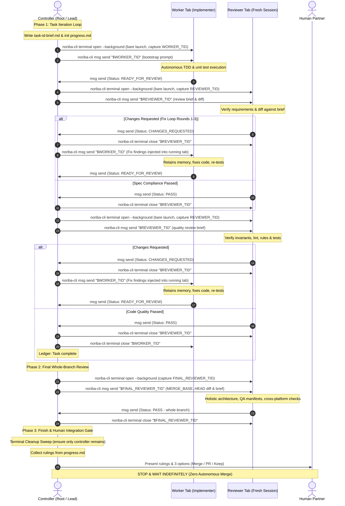

# noriba Subagent-Driven Development

`noriba-subagent-driven-development` executes software implementation plans by orchestrating autonomous subagents (implementers and reviewers) inside native **noriba** terminal tabs. It leverages noriba's native terminal lifecycle management (`noriba-cli terminal open/close`) and inter-terminal peer-to-peer encrypted messaging (`noriba-cli msg send`).

---

## 1. Core Principles

1. **Visible Tabs for Transparent Supervision**: Subagents do not execute in silent background black-boxes. Every implementer, reviewer, and sub-controller runs in a dedicated, visible tab in noriba, allowing real-time developer inspection of ANSI terminal output, compiler diagnostics, and live logs. In SDD orchestration, all subagent tabs are spawned with `--background` so that newly created tabs do not steal active focus from the developer's working terminal.
2. **Context Preservation in Fix Loops**: Implementer worker sessions remain alive and interactive across review fix cycles (Rounds 1–3). When reviewers report defects, fixes are injected directly into the running worker tab via `noriba-cli msg send`, preserving reasoning memory and eliminating costly context reconstructions.
3. **Strict Context Isolation for Two-Stage Reviews**: Spec Compliance and Code Quality reviews are conducted in freshly spawned, independent tabs using top-tier reasoning models. Reviewers evaluate code strictly against disk-backed briefs and Git diffs without inheriting the worker's conversational bias.
4. **Adaptive Execution (Local Fallback vs Distributed Swarm)**: Operates seamlessly on a single workstation via local tabs, or scales across heterogeneous physical workstations over the LAN (e.g. Windows 11 host ⇄ macOS Apple Silicon host) when peers are detected on the noriba messaging bus.
5. **Hierarchical Orchestration with Sub-Controllers**: For large multi-milestone or cross-platform architectures, the Root Controller can delegate localized sub-plans to Sub-Controllers (Area Leads), decentralizing execution while preserving unified progress tracking.
6. **Strict Cost Controls & Mandatory Model Tiering**: Subagents must never be spawned without an explicit `--model <MODEL>` flag. Multi-turn implementation loops are constrained to fast, low-cost models (`--model sonnet --effort low`, `gemini-3.8-flash-low`, `gpt-6-sol`), while deep single-turn evaluation is reserved for capable reasoning models (`--model opus --effort high`, `gemini-4-argon-high`, `gpt-6-astra`).
7. **Data Privacy & Training Boundaries**: Phase 0 enforces a mandatory human gate to assess Work vs Non-Work context. Consumer tiers that train on user inputs (e.g. Google AI Pro) are strictly excluded on work-related tasks, while child subagent CLI engines are decoupled from the parent controller.
8. **Three-Phase Quality Lifecycle**: Execution proceeds strictly through three disciplined phases: Phase 1 (Per-Task Loops) -> Phase 2 (Final Whole-Branch Review) -> Phase 3 (Finish & Human Integration Gate).
9. **Zero Autonomous Merge Invariant**: The agent must NEVER autonomously merge pull requests into `main` or any protected branch. All branch integration decisions belong exclusively to the human partner.
10. **Strict Terminal Lifecycle Teardown**: The controller takes explicit ownership of terminal lifecycles. Reviewer tabs are closed immediately upon receiving a verdict (`PASS` or `CHANGES_REQUESTED`) via `noriba-cli terminal close "$REVIEWER_TID"`. Worker tabs are closed immediately upon passing Stage 2 review. The controller must never rely on `--close-on-exit` alone because interactive CLI engines remain alive at the prompt after sending messages.
11. **Direct Terminal ID Delivery**: To prevent role collisions and eliminate ghost tabs when multiple tabs share identical roles or iterate quickly, all message dispatches to subagents target the captured terminal UUID directly (`noriba-cli msg send "$TID"`).
12. **Active Watchdog Protection**: The controller must never wait passively indefinitely for subagent messages. It runs an active 60-second watchdog monitoring disk handoff files (`task-<id>-report.md`, findings files) and terminal liveliness. When a definitive status line is present on disk, it auto-advances; if total silence exceeds 5 minutes, it escalates to the human partner.

---

## 2. Architecture & Lifecycle

### Turn Lifecycle Sequence



### Roles Breakdown

| Role | Responsibility | Execution Environment |
| :--- | :--- | :--- |
| **Root Controller** | Overall plan orchestration, topology discovery, node registry, task dispatching, whole-branch review, and human integration gate. | Primary interactive shell in noriba. |
| **Sub-Controller (Area Lead)** | Milestone or subsystem sub-plan coordination (e.g. platform-specific subsystem or major crate). | Dedicated controller tab on local or remote node. |
| **Implementer (Worker)** | Test-driven implementation of a single task, cross-platform checks, and report generation. | Long-running terminal tab (kept open during fix loops). |
| **Spec Compliance Reviewer** | Verification that code strictly adheres to requirements in task brief and design spec. | Fresh, isolated terminal tab (closed after review). |
| **Code Quality Reviewer** | Verification of code structure, style, invariants, safety rules, and tests. | Fresh, isolated terminal tab (closed after review). |
| **Security Reviewer** | (Conditional) Verification of IPC DACL, shell escaping, crypto nonces, WebView file isolation, and canonical paths when declared in spec/plan. | Fresh, isolated terminal tab with advanced reasoning model. |
| **Whole-Branch Reviewer** | Holistic evaluation of entire branch diff (`MERGE_BASE..HEAD`), architectural cohesion, QA manifests, and cross-platform builds. | Fresh, isolated terminal tab with advanced reasoning model. |

---

## 3. Multi-CLI Model Catalog & Reasoning Tiering

This skill supports multiple AI CLI engines (`claude`, `agy`, `codex`) and matches model tiers and reasoning effort to task complexity:

| Role | Claude Code (`claude`) | Antigravity CLI (`agy`) *(Non-Work)* | OpenAI Codex CLI (`codex`) |
| :--- | :--- | :--- | :--- |
| **Worker (Unit Implementer)** | `--model sonnet --effort low`<br>*(small tasks: `--model haiku`)* | `--model gemini-3.8-flash-low --effort low` | `-m gpt-6-sol -c reasoning_effort="low"` |
| **Worker (Complex Subsystem)**| `--model sonnet --effort low` | `--model gemini-3.8-flash-medium --effort low` | `-m gpt-6-sol -c reasoning_effort="low"` |
| **Spec Reviewer** | `--model opus --effort high` | `--model gemini-4-argon-high --effort high` | `-m gpt-6-astra -c reasoning_effort="high"` |
| **Code Quality Reviewer** | `--model opus --effort high` | `--model gemini-4-argon-high --effort high` | `-m gpt-6-astra -c reasoning_effort="high"` |
| **Whole-Branch Reviewer** | `--model opus --effort high` | `--model gemini-4-argon-high --effort high` | `-m gpt-6-astra -c reasoning_effort="high"` |
| **Sub-Controller (Area Lead)** | `--model sonnet --effort medium` | `--model gemini-4-argon-medium --effort medium` | `-m gpt-6-sol -c reasoning_effort="medium"` |

> [!CAUTION]
> **Mandatory Model Selection Rule**: Launching a subagent CLI without `--model <MODEL>` is strictly prohibited. Relying on host defaults will cause unconstrained fallback to the most expensive model (e.g. Opus 5.5).

For complete CLI configuration options and engine flags, see the [Model Catalog Reference](references/model-catalog.md).

---

## 4. Messaging Protocol & Pointer Contracts

To eliminate operating system command line length limits and shell escaping errors, all substantive task handoffs rely on disk-backed pointer Markdown files under `.superpowers/sdd/<plan-name>/`:

- **Progress Ledger**: `.superpowers/sdd/<plan-name>/progress.md` (Ledger of completed tasks, commit hashes, and controller rulings).
- **Task Brief**: `.superpowers/sdd/<plan-name>/task-<id>-brief.md` (Scope, requirements, interfaces, files, assertions).
- **Execution Report**: `.superpowers/sdd/<plan-name>/task-<id>-report.md` (Files modified, unit test outputs, commit IDs).
- **Review Findings**: `.superpowers/sdd/<plan-name>/task-<id>-review-findings.md` (Line-by-line defect details and suggested remedies).
- **Final Whole-Branch Review Brief**: `.superpowers/sdd/<plan-name>/final-review-brief.md` (Branch diff range, commit log, spec links).
- **Final Review Findings**: `.superpowers/sdd/<plan-name>/final-review-findings.md` (Whole-branch defect list and remedies).

### Normalized Status Strings

All communications over `noriba-cli msg` must conform to normalized status envelopes:

- `Status: READY_FOR_REVIEW - <task-id>`: Worker signals implementation and unit tests are complete.
- `Status: PASS - <task-id> (<Review-Stage>)`: Reviewer signals that the designated review stage passed with zero defects.
- `Status: CHANGES_REQUESTED - <task-id> (<Review-Stage>, Round <n>)`: Reviewer signals defects were identified and recorded.
- `Status: PASS - whole-branch`: Whole-Branch Reviewer signals branch diff satisfies all specs and invariants.
- `Status: CHANGES_REQUESTED - whole-branch`: Whole-Branch Reviewer signals branch-level defects identified.
- `Status: SUB-PLAN COMPLETE - <area>`: Sub-Controller signals that all tasks in its delegated scope are verified and merged.
- `Status: BLOCKED - <reason>`: Subagent signals an unrecoverable environment or dependency failure.

### Active File-Driven Watchdog Loop

Because messaging events over PTY paste may occasionally be dropped, delayed, or fail to wake an idle parent process, the controller must NEVER rely solely on passive event reception. While awaiting subagent completion (worker implementation, Stage 1/2 reviews, whole-branch review), the controller runs an active polling watchdog:

1. **Check Interval**: 60 seconds.
2. **Monitored Targets**:
   - Primary Disk Artifact: Presence and last-modified timestamp of the relevant handoff artifact (`task-<id>-report.md`, `task-<id>-review-findings.md`, `final-review-findings.md`).
   - Terminal & Bus Liveliness: Verification that the subagent terminal is still registered on `noriba-cli msg list` and active in `noriba-cli terminal list`.
3. **Autonomous Auto-Detection Fallback**:
   - If the disk artifact contains an explicit terminal status envelope (`Status: READY_FOR_REVIEW`, `Status: PASS`, `Status: CHANGES_REQUESTED`), the controller treats the handoff as fully complete **even if no message was received on the bus**, immediately advancing to the next workflow step.
4. **Timeout Escalation**:
   - If 5 consecutive minutes elapse without any file modifications or status updates, and the subagent process remains unresponsive, the controller must pause execution, alert the human partner with diagnostic details (PID, TID, disk file state), and await manual instructions.

For complete protocol details, transport mechanisms, and bracketed paste behaviors, see the [Messaging Protocol Specification](references/messaging-protocol.md).

---

## 5. Execution Workflow

When invoked with an implementation plan (e.g. `/noriba-subagent-driven-development <plan-file-path>`), execute the following three disciplined phases:

### Phase 0: Setup, Plan Reading & Topology Discovery

#### Step 0.1: Work vs. Non-Work Privacy Assessment (Mandatory Human Gate)
Before launching any subagent tabs or initializing topology, the Controller MUST ask the user:
> *"Is this task for Work (confidential / model training prohibited) or Non-Work (personal / OSS)?"*

- **If Work**:
  - Prohibit `agy` under consumer accounts (such as "Google AI Pro" where inputs train models).
  - Restrict subagent engines to zero-data-retention options (`claude` via commercial API / Enterprise, or `codex`).
- **If Non-Work / OSS**:
  - Permit `agy` (`gemini-3.8-flash-low`, `gemini-4-argon-high`), `claude`, and `codex`.
- **Engine Decoupling**: The child subagent CLI engine is chosen independently from the parent controller (e.g. an Antigravity controller can freely dispatch Claude Code subagents).

Record selections in `.superpowers/sdd/<plan-name>/environment.md`:
```markdown
# SDD Environment
- privacy_mode: work | non-work
- engine: claude | agy | codex
- worker_model: <exact-model-string>
- reviewer_model: <exact-model-string>
```

#### Step 0.2: Read Specifications
- Read the implementation plan file (`<plan-file-path>`).
- Read the referenced Design Spec under `docs/superpowers/specs/`.
- Read `AGENTS.md` and relevant rules under `.agents/rules/`.

#### Step 0.3: Initialize Workspace & Progress Ledger
- Create storage directory: `.superpowers/sdd/<plan-name>/`.
- Initialize progress ledger at `.superpowers/sdd/<plan-name>/progress.md` with:
  ```markdown
  # SDD Ledger — plan: <plan-file-path>
  ```
- **Compaction Recovery**: If resuming after context compaction or session interruption, read `progress.md`. Tasks marked complete do not need re-dispatch. Any controller decisions overriding ambiguities or defects must be recorded in the ledger as:
  ```markdown
  Task <N>: Ruling: <decision> — <reason> — <cost if wrong>
  ```

#### Step 0.4: Register Controller
- Check registration status: `noriba-cli msg status`.
- If not joined, join the bus:
  ```bash
  noriba-cli msg join --role controller --auto-enter
  ```

#### Step 0.5: Discover Topology & Node Registry
- Run `noriba-cli msg list` to detect active peers on the LAN.
- If remote machines are detected (e.g. a macOS Apple Silicon peer while running on Windows):
  - Probe remote capabilities (OS, CPU architecture, git branch status) via `noriba-cli msg send`.
  - Construct a Node Registry assigning platform-specific tasks (e.g. macOS Metal/AppKit to the Mac peer, Windows ConPTY/Direct2D to the Windows peer).
  - Activate **Distributed Swarm Mode**.
- If no remote peers are detected:
  - Activate **Local Fallback Mode** (all workers and reviewers spawn as local noriba tabs).

---

### Phase 1: Task Iteration Loop

For each task defined in the plan:

#### Step 1.1: Generate Task Brief
Write the disk-backed task brief at `.superpowers/sdd/<plan-name>/task-<id>-brief.md`:
- Task ID and title.
- Exact file paths to create or modify.
- Target requirements and interfaces.
- Test scenarios and assertions.
- Links to relevant spec sections and invariants.

#### Step 1.2: Dispatch Worker Subagent
Determine whether the task is executed locally or delegated remotely:

- **Local Tab Dispatch**:
  Spawn a dedicated, visible worker tab without `--close-on-exit` (so the tab stays open for fix loops) using the exact engine and model recorded in `environment.md`. Dispatch uses a decoupled two-step procedure: bare process launch via `terminal open` (capturing the terminal UUID), followed by prompt delivery via `noriba-cli msg send`:
  
  *Step A: Bare Process Launch*
  - Claude Code:
    ```bash
    WORKER_TID=$(noriba-cli terminal open --background --role "worker-<id>" --desc "Worker Task <id>" -- claude --model sonnet --effort low --dangerously-skip-permissions)
    ```
  - Antigravity CLI (Non-Work Only):
    ```bash
    WORKER_TID=$(noriba-cli terminal open --background --role "worker-<id>" --desc "Worker Task <id>" -- agy --model gemini-3.8-flash-low --effort low --dangerously-skip-permissions)
    ```
  - OpenAI Codex:
    ```bash
    WORKER_TID=$(noriba-cli terminal open --background --role "worker-<id>" --desc "Worker Task <id>" -- codex -m gpt-6-sol -c reasoning_effort="low" --dangerously-bypass-approvals-and-sandbox)
    ```

  *Step B: Prompt Delivery via Messaging*
  ```bash
  noriba-cli msg send "$WORKER_TID" "<bootstrap-prompt>"
  ```

  > [!NOTE]
  > `noriba-cli terminal open` prints the created terminal UUID (`<TID>`) to stdout. Capturing this UUID and sending directly via `noriba-cli msg send "$TID"` guarantees 1:1 delivery to the intended terminal, preventing role collision. Passing `--role <ROLE>` upon creation registers the terminal role on the messaging bus and automatically enables `--auto-enter`. Prompt payloads delivered via `noriba-cli msg send` are reliably pasted and submitted into the agent PTY with a trailing carriage return (`\r`), eliminating CLI argument-length limits and shell escaping issues.

  The bootstrap prompt instructs the worker to follow the [Implementer Prompt Contract](prompts/implementer-prompt.md), implement using TDD, write `.superpowers/sdd/<plan-name>/task-<id>-report.md`, and report readiness.

- **Remote Swarm Delegation**:
  1. Commit current work and push topic branch: `git push origin <branch>`.
  2. Send delegation message to the remote peer:
     ```bash
     noriba-cli msg send --role "<remote-worker-role>" "Start Task <id>: brief at .superpowers/sdd/<plan-name>/task-<id>-brief.md on branch <branch>. Pull before starting."
     ```

#### Step 1.3: Await Worker Completion
Wait for the worker's status message (`Status: READY_FOR_REVIEW - <id>`) or detect it via the **Active Watchdog Loop**:
1. Check every 60 seconds for updates to `.superpowers/sdd/<plan-name>/task-<id>-report.md` and verify process liveliness via `noriba-cli msg list`.
2. If `Status: READY_FOR_REVIEW - <id>` appears in the report file, proceed immediately to review even if the incoming message notification was missed.
3. If 5 consecutive minutes pass without disk updates or process activity, pause and escalate to the human partner.

If the worker sends `Status: BLOCKED - <reason>`, investigate the blocker, resolve dependencies, or provide guidance via `noriba-cli msg send "$WORKER_TID"`.

#### Step 1.4: Stage 1 Review - Spec Compliance
1. Spawn a fresh, isolated tab for the Spec Compliance Reviewer using the capable reasoning model from `environment.md`, capturing its terminal ID, followed by prompt delivery over messaging:
   
   *Step A: Bare Process Launch*
   - Claude Code:
     ```bash
     REVIEWER_TID=$(noriba-cli terminal open --background --role "reviewer-spec-<id>" --desc "Spec Reviewer Task <id>" -- claude --model opus --effort high --dangerously-skip-permissions)
     ```
   - Antigravity CLI (Non-Work Only):
     ```bash
     REVIEWER_TID=$(noriba-cli terminal open --background --role "reviewer-spec-<id>" --desc "Spec Reviewer Task <id>" -- agy --model gemini-4-argon-high --effort high --dangerously-skip-permissions)
     ```
   - OpenAI Codex:
     ```bash
     REVIEWER_TID=$(noriba-cli terminal open --background --role "reviewer-spec-<id>" --desc "Spec Reviewer Task <id>" -- codex -m gpt-6-astra -c reasoning_effort="high" --dangerously-bypass-approvals-and-sandbox)
     ```

   *Step B: Prompt Delivery via Messaging*
   ```bash
   noriba-cli msg send "$REVIEWER_TID" "<spec-reviewer-bootstrap>"
   ```

   The bootstrap prompt directs the reviewer to execute the [Spec Reviewer Prompt Contract](prompts/spec-reviewer-prompt.md).
2. Await reviewer verdict (via status message or 60s active watchdog checking `.superpowers/sdd/<plan-name>/task-<id>-review-findings.md`):
   - **Passed (`Status: PASS - <id> (Spec Compliance)`)**:
     1. Close the reviewer tab immediately:
        ```bash
        noriba-cli terminal close "$REVIEWER_TID"
        ```
     2. Proceed immediately to Stage 2 Review.
   - **Changes Requested (`Status: CHANGES_REQUESTED - <id> (Spec Compliance, Round <R>)`)**:
     1. Close the reviewer tab immediately:
        ```bash
        noriba-cli terminal close "$REVIEWER_TID"
        ```
     2. Verify reviewer findings at `.superpowers/sdd/<plan-name>/task-<id>-review-findings.md`.
     3. If round $R \le 3$, inject the fix directive into the still-running worker tab:
        ```bash
        noriba-cli msg send "$WORKER_TID" "Fix Round <R>: Review findings in .superpowers/sdd/<plan-name>/task-<id>-review-findings.md. Apply fixes, re-test, update report, and report Status: READY_FOR_REVIEW - <id>."
        ```
     4. Await worker completion and re-dispatch Spec Compliance Review (capturing a fresh `$REVIEWER_TID`).
     5. If round $R > 3$, pause and adjudicate whether the issue is a plan defect or escalate to the human partner.

#### Step 1.5: Stage 2 Review - Code Quality
1. Spawn a fresh, isolated tab for the Code Quality Reviewer using the capable reasoning model from `environment.md`, capturing its terminal ID, followed by prompt delivery over messaging:
   
   *Step A: Bare Process Launch*
   - Claude Code:
     ```bash
     REVIEWER_TID=$(noriba-cli terminal open --background --role "reviewer-quality-<id>" --desc "Quality Reviewer Task <id>" -- claude --model opus --effort high --dangerously-skip-permissions)
     ```
   - Antigravity CLI (Non-Work Only):
     ```bash
     REVIEWER_TID=$(noriba-cli terminal open --background --role "reviewer-quality-<id>" --desc "Quality Reviewer Task <id>" -- agy --model gemini-4-argon-high --effort high --dangerously-skip-permissions)
     ```
   - OpenAI Codex:
     ```bash
     REVIEWER_TID=$(noriba-cli terminal open --background --role "reviewer-quality-<id>" --desc "Quality Reviewer Task <id>" -- codex -m gpt-6-astra -c reasoning_effort="high" --dangerously-bypass-approvals-and-sandbox)
     ```

   *Step B: Prompt Delivery via Messaging*
   ```bash
   noriba-cli msg send "$REVIEWER_TID" "<quality-reviewer-bootstrap>"
   ```

   The bootstrap prompt directs the reviewer to execute the [Quality Reviewer Prompt Contract](prompts/quality-reviewer-prompt.md).
2. Await reviewer verdict (via status message or 60s active watchdog checking `.superpowers/sdd/<plan-name>/task-<id>-review-findings.md`):
   - **Passed (`Status: PASS - <id> (Code Quality)`)**:
     1. Close the reviewer tab immediately:
        ```bash
        noriba-cli terminal close "$REVIEWER_TID"
        ```
     2. Both reviews have passed! Proceed to Step 1.6.
   - **Changes Requested (`Status: CHANGES_REQUESTED - <id> (Code Quality, Round <R>)`)**:
     1. Close the reviewer tab immediately:
        ```bash
        noriba-cli terminal close "$REVIEWER_TID"
        ```
     2. Inject fix directive into the running worker tab:
        ```bash
        noriba-cli msg send "$WORKER_TID" "Fix Round <R>: Quality review findings in .superpowers/sdd/<plan-name>/task-<id>-review-findings.md. Apply fixes, re-test, update report, and report Status: READY_FOR_REVIEW - <id>."
        ```
     3. Await worker completion and repeat review verification (capturing a fresh `$REVIEWER_TID`).

#### Step 1.6: Task Completion, PR Commenting & Tab Teardown
1. Close the worker tab cleanly:
   ```bash
   noriba-cli terminal close "$WORKER_TID"
   ```
2. Verify that no stray reviewer tabs remain open:
   ```bash
   noriba-cli terminal list
   ```
3. Append completion record to `.superpowers/sdd/<plan-name>/progress.md`:
   ```markdown
   Task <N>: complete (commits <base7>..<head7>, review clean)
   ```
4. Mark task as completed (`- [x]`) in the implementation plan.
5. Push commits and sync with Pull Request:
   - If Task 1 was just completed and no PR exists yet, create the draft PR:
     ```bash
     git push -u origin <branch>
     gh pr create --draft --title "<Area>: <what>" --body "Closes #<N>."
     ```
   - Push task commits to origin:
     ```bash
     git push origin <branch>
     ```
   - Post task review verdict to PR comments:
     ```bash
     gh pr comment <PR_NUMBER> --body "### Task <N> Review Complete: <Title>
- **Spec Compliance**: PASS
- **Code Quality**: PASS
- Commits: \`<base7>..<head7>\`"
     ```

---

### Phase 2: Final Whole-Branch & Conditional Security Review

After all tasks in the plan have been marked complete in `progress.md`:

#### Step 2.1: Generate Whole-Branch Review Brief
1. Determine branch diff boundaries:
   ```bash
   MERGE_BASE=$(git merge-base origin/main HEAD 2>/dev/null || git merge-base main HEAD)
   ```
2. Write `.superpowers/sdd/<plan-name>/final-review-brief.md`:
   - `MERGE_BASE` and `HEAD` commit hashes.
   - Summarized commit log (`git log --oneline $MERGE_BASE..HEAD`).
   - Changed files and diff statistics (`git diff --stat $MERGE_BASE..HEAD`).
   - Links to the plan, design spec, and applicable QA manifests (`docs/qa/*.toml`).
   - Summary of any parked items or rulings recorded in `progress.md`.

#### Step 2.2: Conditional Security Review
Check if the Implementation Plan or Design Spec declares `Security Review: Required`:
- **If Required**:
  1. Spawn a dedicated, isolated Security Reviewer tab using `prompts/security-reviewer-prompt.md`, capturing its terminal ID:
     ```bash
     SECURITY_REVIEWER_TID=$(noriba-cli terminal open --background --role "reviewer-security" --desc "Security Reviewer" -- claude --model opus --effort high --dangerously-skip-permissions)
     ```
  2. Deliver review prompt via `noriba-cli msg send`:
     ```bash
     noriba-cli msg send "$SECURITY_REVIEWER_TID" "Execute security review for branch diff $MERGE_BASE..HEAD. Brief at .superpowers/sdd/<plan-name>/final-review-brief.md."
     ```
  3. Await verdict (`Status: PASS - security`):
     - Immediately close the security reviewer tab upon receiving the verdict:
       ```bash
       noriba-cli terminal close "$SECURITY_REVIEWER_TID"
       ```
     - If changes requested, resolve with a worker tab before proceeding.
  4. Post security verdict to PR comment:
     ```bash
     gh pr comment <PR_NUMBER> --body "### Security Review: PASS
Branch diff audited against IPC DACL, shell escaping, cryptographic invariants, and path traversal checks."
     ```
- **If Not Required**: Skip to Step 2.3.

#### Step 2.3: Dispatch Whole-Branch Reviewer
Spawn an isolated reviewer tab with an advanced reasoning model (`opus --effort high`, `gemini-4-argon-high`, or `gpt-6-astra`), capturing its terminal ID:

*Step A: Process Launch*
- Claude Code:
  ```bash
  FINAL_REVIEWER_TID=$(noriba-cli terminal open --background --role "reviewer-final" --desc "Whole-Branch Reviewer" -- claude --model opus --effort high --dangerously-skip-permissions)
  ```
- Antigravity CLI (Non-Work Only):
  ```bash
  FINAL_REVIEWER_TID=$(noriba-cli terminal open --background --role "reviewer-final" --desc "Whole-Branch Reviewer" -- agy --model gemini-4-argon-high --effort high --dangerously-skip-permissions)
  ```
- OpenAI Codex:
  ```bash
  FINAL_REVIEWER_TID=$(noriba-cli terminal open --background --role "reviewer-final" --desc "Whole-Branch Reviewer" -- codex -m gpt-6-astra -c reasoning_effort="high" --dangerously-bypass-approvals-and-sandbox)
  ```

*Step B: Prompt Delivery via Messaging*
```bash
noriba-cli msg send "$FINAL_REVIEWER_TID" "<whole-branch-reviewer-bootstrap>"
```
The bootstrap prompt directs the reviewer to execute the [Whole-Branch Reviewer Prompt Contract](prompts/whole-branch-reviewer-prompt.md).

#### Step 2.4: Adjudicate Findings & Final Clean Gate
1. Await reviewer verdict (via status message or 60s active watchdog checking `.superpowers/sdd/<plan-name>/final-review-findings.md`):
   - **Passed (`Status: PASS - whole-branch`)**:
     1. Close the reviewer tab immediately:
        ```bash
        noriba-cli terminal close "$FINAL_REVIEWER_TID"
        ```
     2. Whole-branch evaluation is clean!
        Post whole-branch approval to PR comment:
        ```bash
        gh pr comment <PR_NUMBER> --body "### Whole-Branch Review: APPROVED
Branch diff $MERGE_BASE..HEAD satisfies architectural cohesion, cross-platform integrity, and QA guidelines."
        ```
        Proceed to Phase 3.
   - **Changes Requested (`Status: CHANGES_REQUESTED - whole-branch`)**:
     1. Close the reviewer tab immediately:
        ```bash
        noriba-cli terminal close "$FINAL_REVIEWER_TID"
        ```
     2. Review findings in `.superpowers/sdd/<plan-name>/final-review-findings.md`.
     3. Dispatch at most ONE consolidated fix wave to an implementer tab.
     4. Verify fixes with a scoped re-review tab.
     5. Adjudicate any residual non-load-bearing findings by recording rulings in `progress.md`.

---

### Phase 3: Finish & Human Integration Gate

Once the whole-branch review passes cleanly:

#### Step 3.1: Terminal Cleanup Sweep
Perform an active terminal cleanup sweep to ensure no auxiliary worker or reviewer tabs remain:
1. List all active terminals in the noriba workspace:
   ```bash
   noriba-cli terminal list
   ```
2. Verify that **ONLY the primary controller terminal** remains open.
3. If any auxiliary worker, reviewer, or sub-controller terminals are still active, forcefully close them:
   ```bash
   noriba-cli terminal close <TID>
   ```
   Never leave extra tabs open when presenting final choices to the human partner.

#### Step 3.2: Summarize Rulings
Collect all lines containing `Ruling:` from `.superpowers/sdd/<plan-name>/progress.md` and present them under `### Rulings I made` in the conversation response for human inspection.

#### Step 3.3: Adaptive Completion Gate
Check whether the `superpowers:finishing-a-development-branch` skill is registered in the agent's available skills catalog:

- **Case A: Superpowers Available**:
  Delegate directly:
  ```text
  Use superpowers:finishing-a-development-branch.
  ```

- **Case B: Superpowers Absent (Native Finish Protocol)**:
  Execute the native completion protocol directly:
  1. **Run Verification Commands**:
     - `cargo check-win`
     - `cargo check-mac`
     - `cargo clippy --workspace --all-targets -- -D warnings`
     - `cargo fmt --all --check`
     - `cargo xtask qa lint`
     - `cargo test --workspace`
  2. **Present Canonical Human Choices**:
     Display the exact three integration options and **STOP / WAIT INDEFINITELY**:
     ```text
     Implementation and whole-branch review are complete! What would you like to do?

     1. Merge back to <base-branch> locally
     2. Push and create a Pull Request
     3. Keep the branch as-is (I'll handle it later)

     Which option?
     ```
  3. **Execute Chosen Option Upon Explicit Human Instruction**:
     - **If Option 1 (Local Merge)**: Switch to `<base-branch>`, pull latest, merge topic branch, verify tests, and delete topic branch if requested.
     - **If Option 2 (Pull Request)**: Push topic branch (`git push origin <branch>`), create PR via `gh pr create`, output the PR link, and **STOP IMMEDIATELY**.
     - **If Option 3 (Keep Branch)**: Retain branch and report.
  4. **Clean Workspace Scratch**:
     Remove `.superpowers/sdd/<plan-name>/`.

> [!CAUTION]
> **ZERO AUTONOMOUS MERGE INVARIANT**:
> The controller agent MUST NEVER run `gh pr merge` or merge pull requests into `main` or any protected branch autonomously. PR merging requires human review on GitHub or an explicit, conversational command from the human partner.

---

## 6. Stopping Conditions

The controller agent executes implementation tasks continuously without interrupting the human partner between tasks. However, four non-negotiable conditions halt execution immediately:

1. **Irreversible or Destructive Operations**: Any command that permanently deletes uncommitted code, destroys stashes, drops worktrees with unpushed work, or performs force-pushes (`git push --force`).
2. **Security-Sensitive Actions**: Accessing, modifying, or transferring secrets, certificates, authentication tokens, API keys, or permissions.
3. **External Side Effects Outside Worktree (Zero Autonomous Merge)**:
   - Autonomous merging of pull requests into `main` or any protected branch (`gh pr merge`).
   - Pushing commits directly to protected branches (`main`, `master`, `release/*`) without a pull request.
   - Publishing releases, crates, or packages.
4. **Unresolvable Plan Defects**: When requirements in the implementation plan fundamentally contradict the codebase and every possible forward path is pure guesswork.

Whenever one of these four conditions is reached, STOP immediately and ask the human partner for explicit guidance.

---

## 7. Hierarchical Sub-Controller Delegation

For large, multi-area initiatives, the Root Controller can delegate entire sub-plans:

1. **Sub-Plan Definition**: Create `.superpowers/sdd/<plan-name>/subplan-<area>.md`.
2. **Sub-Controller Dispatch**:
   - Spawn a dedicated sub-controller tab (local or remote) with a capable reasoning model and explicit `--model`, capturing its terminal ID, then deliver its initial instructions via messaging:
     ```bash
     SUB_CONTROLLER_TID=$(noriba-cli terminal open --background --role "controller-<area>" --desc "Area Lead <area>" -- claude --model sonnet --effort medium --dangerously-skip-permissions)
     noriba-cli msg send "$SUB_CONTROLLER_TID" "<lead-bootstrap>"
     ```
3. **Sub-Controller Autonomous Execution**:
   - The Area Lead manages its own local worker and reviewer tabs according to Phase 1.
   - Keeps all intermediate turn noise within its area.
4. **Milestone Completion Reporting & Teardown**:
   - The Sub-Controller reports completion back to the Root Controller:
     ```text
     Status: SUB-PLAN COMPLETE - <area>
     ```
   - The Root Controller closes the Sub-Controller tab immediately upon receiving completion:
     ```bash
     noriba-cli terminal close "$SUB_CONTROLLER_TID"
     ```

---

## 8. Invariants & Rules

1. **Preserve Comments & Invariants**: Never defeat, bypass, or weaken subsystem invariants or architectural checks. All existing code comments and docstrings must be preserved.
2. **Strict English Convention**: All code comments, commit messages (strictly single-line), and documentation must be in English.
3. **File Size Guideline**: Maintain the ~1,000 line guideline ([#77](https://github.com/tablyrocks/noriba/issues/77)). Decompose large files behavior-neutrally into modular child components.
4. **Context Isolation**: Never reuse an implementer's conversation context for reviews. Always spin up a fresh tab for reviewers.
5. **Worker Tab Persistence**: Do not pass `--close-on-exit` to implementer worker tabs during task execution. Keep worker sessions alive until both review stages pass.
6. **Zero Bare Subagent Invariant**: Subagents must NEVER be spawned without an explicit `--model <MODEL>` flag. Omitting the model flag or falling back to unconstrained host defaults is strictly prohibited.
7. **Privacy Boundary Compliance**: When executing work-related tasks, never use CLI tools or subscription accounts (such as consumer Google AI Pro) where user prompts are trained on.
8. **Zero Autonomous Merge Invariant**: Never autonomously merge pull requests into `main` or protected branches without explicit human direction. All integration decisions belong exclusively to the human partner.
9. **Strict Lifecycle Teardown Invariant**: Reviewer terminals must be closed via `noriba-cli terminal close "$REVIEWER_TID"` immediately upon verdict (`PASS` or `CHANGES_REQUESTED`). Worker terminals must be closed via `noriba-cli terminal close "$WORKER_TID"` upon completing Stage 2 review. The controller must never rely on `--close-on-exit` alone, and must ensure only the primary controller terminal remains open upon entering Phase 3.
10. **Direct Terminal ID Targeting Invariant**: Message delivery to subagents must use the captured terminal UUID (`noriba-cli msg send "$TID"`) rather than `--role <ROLE>` to eliminate multi-tab collisions and ghost tabs.
11. **Active Watchdog Invariant**: The controller must never wait passively indefinitely for subagent messages. It must actively poll disk artifacts (`task-<id>-report.md`, findings files) at 60-second intervals, auto-advance upon detecting definitive status lines, and escalate after 5 minutes of total inactivity.

---

## 9. Reference Links

- [Model Catalog Reference](references/model-catalog.md)
- [Messaging Protocol Specification](references/messaging-protocol.md)
- [Implementer Prompt Contract](prompts/implementer-prompt.md)
- [Spec Reviewer Prompt Contract](prompts/spec-reviewer-prompt.md)
- [Quality Reviewer Prompt Contract](prompts/quality-reviewer-prompt.md)
- [Whole-Branch Reviewer Prompt Contract](prompts/whole-branch-reviewer-prompt.md)
