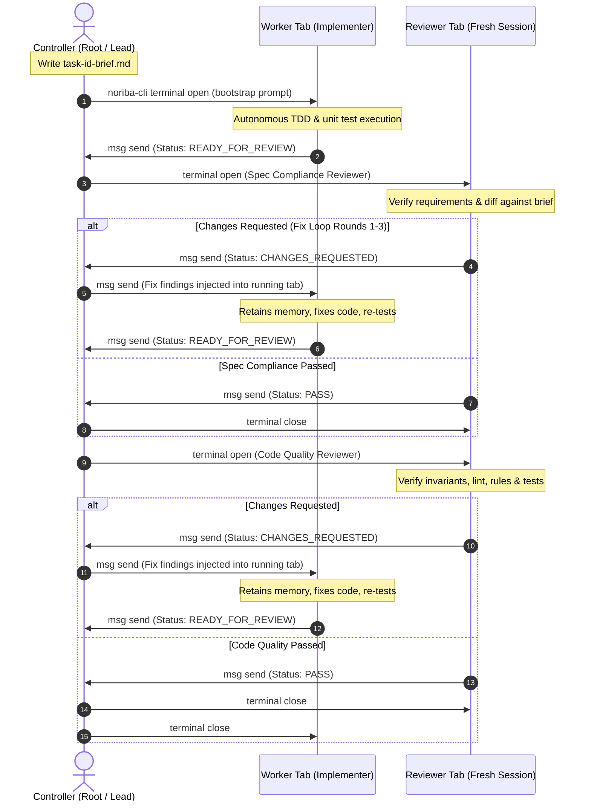

# noriba Subagent-Driven Development

`noriba-subagent-driven-development` executes software implementation plans by orchestrating autonomous subagents (implementers and reviewers) inside native **noriba** terminal tabs. It leverages noriba's native terminal lifecycle management (`noriba-cli terminal open/close`) and inter-terminal peer-to-peer encrypted messaging (`noriba-cli msg send`).

---

## 1. Core Principles

1. **Visible Tabs for Transparent Supervision**: Subagents do not execute in silent background black-boxes. Every implementer, reviewer, and sub-controller runs in a dedicated, visible tab in noriba, allowing real-time developer inspection of ANSI terminal output, compiler diagnostics, and live logs.
2. **Context Preservation in Fix Loops**: Implementer worker sessions remain alive and interactive across review fix cycles (Rounds 1–3). When reviewers report defects, fixes are injected directly into the running worker tab via `noriba-cli msg send`, preserving reasoning memory and eliminating costly context reconstructions.
3. **Strict Context Isolation for Two-Stage Reviews**: Spec Compliance and Code Quality reviews are conducted in freshly spawned, independent tabs using top-tier reasoning models. Reviewers evaluate code strictly against disk-backed briefs and Git diffs without inheriting the worker's conversational bias.
4. **Adaptive Execution (Local Fallback vs Distributed Swarm)**: Operates seamlessly on a single workstation via local tabs, or scales across heterogeneous physical workstations over the LAN (e.g. Windows 11 host ⇄ macOS Apple Silicon host) when peers are detected on the noriba messaging bus.
5. **Hierarchical Orchestration with Sub-Controllers**: For large multi-milestone or cross-platform architectures, the Root Controller can delegate localized sub-plans to Sub-Controllers (Area Leads), decentralizing execution while preserving unified progress tracking.

---

## 2. Architecture & Lifecycle

### Turn Lifecycle Sequence



### Roles Breakdown

| Role | Responsibility | Execution Environment |
| :--- | :--- | :--- |
| **Root Controller** | Overall plan orchestration, topology discovery, node registry, task dispatching, final whole-branch integration. | Primary interactive shell in noriba. |
| **Sub-Controller (Area Lead)** | Milestone or subsystem sub-plan coordination (e.g. platform-specific subsystem or major crate). | Dedicated controller tab on local or remote node. |
| **Implementer (Worker)** | Test-driven implementation of a single task, cross-platform checks, and report generation. | Long-running terminal tab (kept open during fix loops). |
| **Spec Compliance Reviewer** | Verification that code strictly adheres to requirements in task brief and design spec. | Fresh, isolated terminal tab (closed after review). |
| **Code Quality Reviewer** | Verification of code structure, style, invariants, safety rules, and tests. | Fresh, isolated terminal tab (closed after review). |

---

## 3. Multi-CLI Model Catalog & Reasoning Tiering

This skill supports multiple AI CLI engines (`claude`, `agy`, `codex`) and matches model tiers and reasoning effort to task complexity:

| Role | Claude Code (`claude`) | Antigravity CLI (`agy`) | OpenAI Codex CLI (`codex`) |
| :--- | :--- | :--- | :--- |
| **Worker (Unit Implementer)** | `--model haiku` | `--model gemini-3.8-flash-low` | `-m gpt-6-luna` |
| **Worker (Complex Subsystem)**| `--model sonnet` | `--model gemini-3.8-flash-high` | `-m gpt-6-sol` |
| **Spec Reviewer** | `--model opus --effort high` | `--model gemini-4-argon-high --effort high` | `-m gpt-6-astra -c reasoning_effort="high"` |
| **Code Quality Reviewer** | `--model opus --effort high` | `--model gemini-4-argon-high --effort high` | `-m gpt-6-astra -c reasoning_effort="high"` |
| **Sub-Controller (Area Lead)** | `--model opus --effort high` | `--model gemini-4-argon-high --effort high` | `-m gpt-6-astra -c reasoning_effort="high"` |

For complete CLI configuration options and engine flags, see the [Model Catalog Reference](references/model-catalog.md).

---

## 4. Messaging Protocol & Pointer Contracts

To eliminate operating system command line length limits and shell escaping errors, all substantive task handoffs rely on disk-backed pointer Markdown files under `.superpowers/sdd/<plan-name>/`:

- **Task Brief**: `.superpowers/sdd/<plan-name>/task-<id>-brief.md` (Scope, requirements, interfaces, files, assertions).
- **Execution Report**: `.superpowers/sdd/<plan-name>/task-<id>-report.md` (Files modified, unit test outputs, commit IDs).
- **Review Findings**: `.superpowers/sdd/<plan-name>/task-<id>-review-findings.md` (Line-by-line defect details and suggested remedies).

### Normalized Status Strings

All communications over `noriba-cli msg` must conform to normalized status envelopes:

- `Status: READY_FOR_REVIEW - <task-id>`: Worker signals implementation and unit tests are complete.
- `Status: PASS - <task-id> (<Review-Stage>)`: Reviewer signals that the designated review stage passed with zero defects.
- `Status: CHANGES_REQUESTED - <task-id> (<Review-Stage>, Round <n>)`: Reviewer signals defects were identified and recorded.
- `Status: SUB-PLAN COMPLETE - <area>`: Sub-Controller signals that all tasks in its delegated scope are verified and merged.
- `Status: BLOCKED - <reason>`: Subagent signals an unrecoverable environment or dependency failure.

For complete protocol details, transport mechanisms, and bracketed paste behaviors, see the [Messaging Protocol Specification](references/messaging-protocol.md).

---

## 5. Execution Workflow

When invoked with an implementation plan (e.g. `/noriba-subagent-driven-development <plan-file-path>`), execute the following phases:

### Phase 0: Setup, Plan Reading & Topology Discovery

1. **Read Specifications**:
   - Read the implementation plan file (`<plan-file-path>`).
   - Read the referenced Design Spec under `docs/superpowers/specs/`.
   - Read `AGENTS.md` and relevant rules under `.agents/rules/`.
2. **Initialize Workspace**:
   - Create storage directory: `.superpowers/sdd/<plan-name>/`.
3. **Register Controller**:
   - Check registration status: `noriba-cli msg status`.
   - If not joined, join the bus:
     ```bash
     noriba-cli msg join --role controller --auto-enter
     ```
4. **Discover Topology & Node Registry**:
   - Run `noriba-cli msg list` to detect active peers on the LAN.
   - If remote machines are detected (e.g. a macOS Apple Silicon peer while running on Windows):
     - Probe remote capabilities (OS, CPU architecture, git branch status) via `noriba-cli msg send`.
     - Construct a Node Registry assigning platform-specific tasks (e.g. macOS Metal/AppKit to the Mac peer, Windows ConPTY/Direct2D to the Windows peer).
     - Activate **Distributed Swarm Mode**.
   - If no remote peers are detected:
     - Activate **Local Fallback Mode** (all workers and reviewers spawn as local noriba tabs).

---

### Phase 1: Task Iteration Loop

For each task defined in the plan:

#### Step 1.1: Generate Task Brief
Write the disk-backed task brief at `.superpowers/sdd/<plan-name>/task-<id>-brief.md`:
- Task ID and title.
- Exact file paths to create or modify.
- Target requirements and interfaces.
- Test scenarios and assertions.
- Links to relevant spec sections and invariants.

#### Step 1.2: Dispatch Worker Subagent
Determine whether the task is executed locally or delegated remotely:

- **Local Tab Dispatch**:
  Spawn a dedicated, visible worker tab without `--close-on-exit` (so the tab stays open for fix loops):
  ```bash
  WORKER_TID=$(noriba-cli terminal open --role "worker-<id>" --desc "Worker Task <id>" -- <cli> --model <worker-model> "<bootstrap-prompt>")
  ```
  The bootstrap prompt instructs the worker to follow the [Implementer Prompt Contract](prompts/implementer-prompt.md), implement using TDD, write `.superpowers/sdd/<plan-name>/task-<id>-report.md`, and report readiness.

- **Remote Swarm Delegation**:
  1. Commit current work and push topic branch: `git push origin <branch>`.
  2. Send delegation message to the remote peer:
     ```bash
     noriba-cli msg send --role "<remote-worker-role>" "Start Task <id>: brief at .superpowers/sdd/<plan-name>/task-<id>-brief.md on branch <branch>. Pull before starting."
     ```

#### Step 1.3: Await Worker Completion
Wait for the worker's status message:
```text
Status: READY_FOR_REVIEW - <id>
```
If the worker sends `Status: BLOCKED - <reason>`, investigate the blocker, resolve dependencies, or provide guidance via `noriba-cli msg send`.

#### Step 1.4: Stage 1 Review - Spec Compliance
1. Spawn a fresh, isolated tab for the Spec Compliance Reviewer using a top-tier capable model:
   ```bash
   noriba-cli terminal open --role "reviewer-spec-<id>" --close-on-exit -- <cli> --model <capable-model> <effort-flag> "<spec-reviewer-bootstrap>"
   ```
   The bootstrap prompt directs the reviewer to execute the [Spec Reviewer Prompt Contract](prompts/spec-reviewer-prompt.md).
2. Await reviewer verdict:
   - **Passed (`Status: PASS - <id> (Spec Compliance)`)**: Proceed immediately to Stage 2 Review.
   - **Changes Requested (`Status: CHANGES_REQUESTED - <id> (Spec Compliance, Round <R>)`)**:
     1. Verify reviewer findings at `.superpowers/sdd/<plan-name>/task-<id>-review-findings.md`.
     2. If round $R \le 3$, inject the fix directive into the still-running worker tab:
        ```bash
        noriba-cli msg send --role "worker-<id>" "Fix Round <R>: Review findings in .superpowers/sdd/<plan-name>/task-<id>-review-findings.md. Apply fixes, re-test, update report, and report Status: READY_FOR_REVIEW - <id>."
        ```
     3. Await worker completion and re-dispatch Spec Compliance Review.
     4. If round $R > 3$, pause and adjudicate whether the issue is a plan defect or escalate to the human partner.

#### Step 1.5: Stage 2 Review - Code Quality
1. Spawn a fresh, isolated tab for the Code Quality Reviewer using a top-tier capable model:
   ```bash
   noriba-cli terminal open --role "reviewer-quality-<id>" --close-on-exit -- <cli> --model <capable-model> <effort-flag> "<quality-reviewer-bootstrap>"
   ```
   The bootstrap prompt directs the reviewer to execute the [Quality Reviewer Prompt Contract](prompts/quality-reviewer-prompt.md).
2. Await reviewer verdict:
   - **Passed (`Status: PASS - <id> (Code Quality)`)**: Both reviews have passed! Proceed to Step 1.6.
   - **Changes Requested (`Status: CHANGES_REQUESTED - <id> (Code Quality, Round <R>)`)**:
     1. Inject fix directive into the running worker tab.
     2. Await worker completion and repeat review verification.

#### Step 1.6: Task Completion & Tab Teardown
1. Close the worker tab cleanly:
   ```bash
   noriba-cli terminal close "$WORKER_TID"
   ```
2. Verify that reviewer tabs have exited cleanly (or close any remaining tab).
3. Mark task as completed (`- [x]`) in the implementation plan.

---

### Phase 2: Final Verification & Clean Teardown

Once all tasks in the plan are completed:

1. **Whole-Workspace Cross-Platform Checks**:
   - Windows build & clippy: `cargo check-win`
   - macOS build & clippy: `cargo check-mac`
   - Workspace lints: `cargo clippy --workspace --all-targets -- -D warnings`
   - Code formatting: `cargo fmt --all --check`
   - Workspace test suite: `cargo test --workspace`
2. **Git Working Tree Audit**:
   - Verify all changes are committed with single-line English commit messages.
   - Run `git status` to ensure a completely clean working directory.
3. **Session Teardown**:
   - Unregister controller from bus if desired: `noriba-cli msg leave`.
   - If executing as part of a feature branch workflow, proceed to branch finalization or integration.

---

## 6. Hierarchical Sub-Controller Delegation

For large, multi-area initiatives, the Root Controller can delegate entire sub-plans:

1. **Sub-Plan Definition**: Create `.superpowers/sdd/<plan-name>/subplan-<area>.md`.
2. **Sub-Controller Dispatch**:
   - Spawn a dedicated sub-controller tab (local or remote) with a capable reasoning model:
     ```bash
     noriba-cli terminal open --role "controller-<area>" -- <cli> --model <capable-model> "<lead-bootstrap>"
     ```
3. **Sub-Controller Autonomous Execution**:
   - The Area Lead manages its own local worker and reviewer tabs according to Phase 1.
   - Keeps all intermediate turn noise within its area.
4. **Milestone Completion Reporting**:
   - The Sub-Controller reports completion back to the Root Controller:
     ```text
     Status: SUB-PLAN COMPLETE - <area>
     ```

---

## 7. Invariants & Rules

1. **Preserve Comments & Invariants**: Never defeat, bypass, or weaken subsystem invariants or architectural checks. All existing code comments and docstrings must be preserved.
2. **Strict English Convention**: All code comments, commit messages (strictly single-line), and documentation must be in English.
3. **File Size Guideline**: Maintain the ~1,000 line guideline ([#77](https://github.com/tablyrocks/noriba/issues/77)). Decompose large files behavior-neutrally into modular child components.
4. **Context Isolation**: Never reuse an implementer's conversation context for reviews. Always spin up a fresh tab for reviewers.
5. **Worker Tab Persistence**: Do not pass `--close-on-exit` to implementer worker tabs during task execution. Keep worker sessions alive until both review stages pass.

---

## 8. Reference Links

- [Model Catalog Reference](references/model-catalog.md)
- [Messaging Protocol Specification](references/messaging-protocol.md)
- [Implementer Prompt Contract](prompts/implementer-prompt.md)
- [Spec Reviewer Prompt Contract](prompts/spec-reviewer-prompt.md)
- [Quality Reviewer Prompt Contract](prompts/quality-reviewer-prompt.md)
